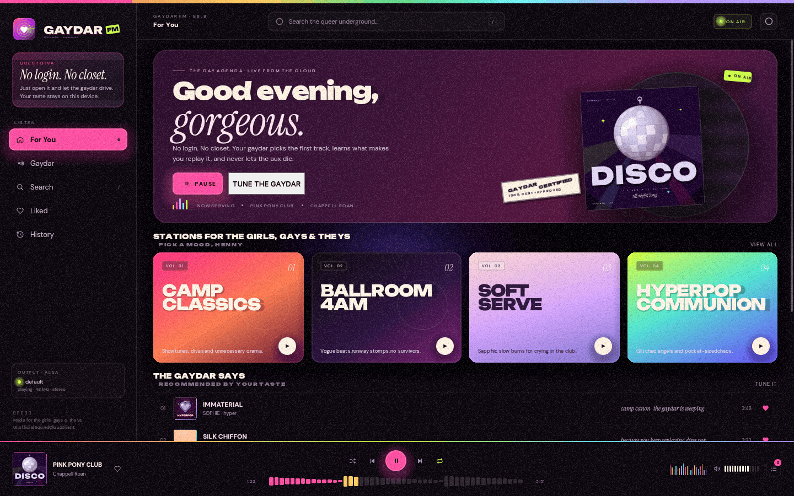
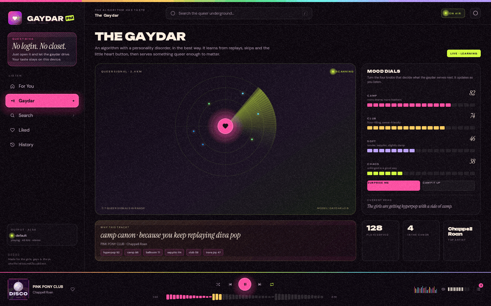
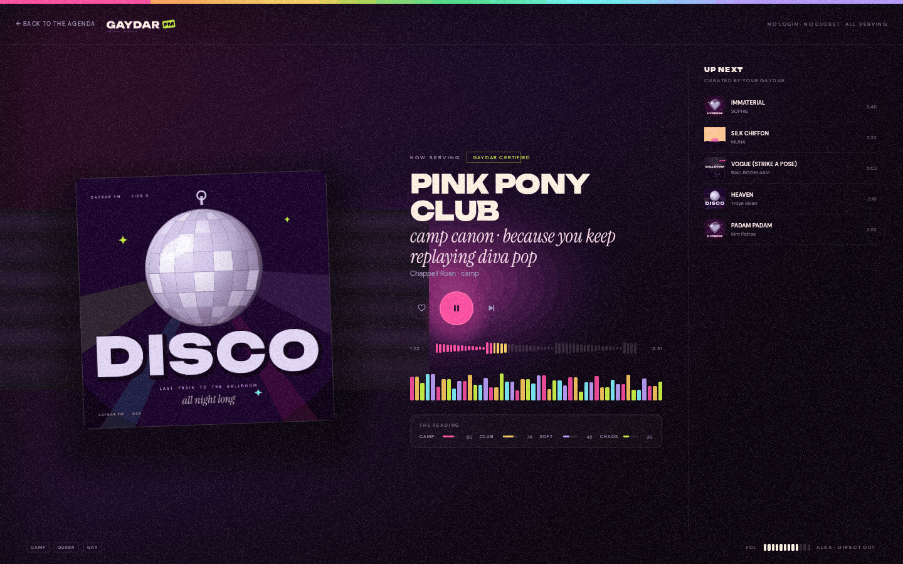
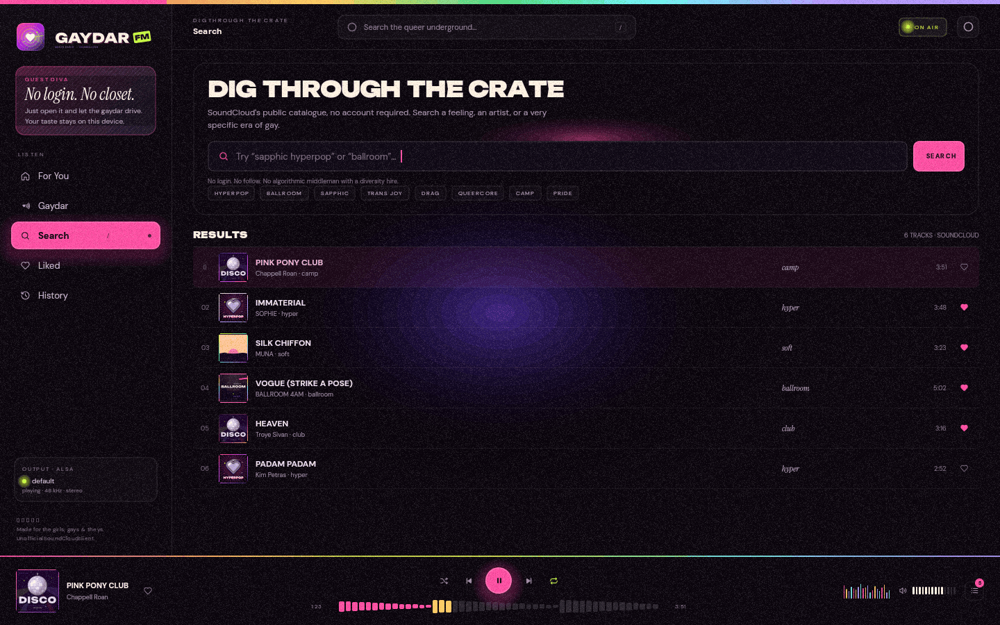
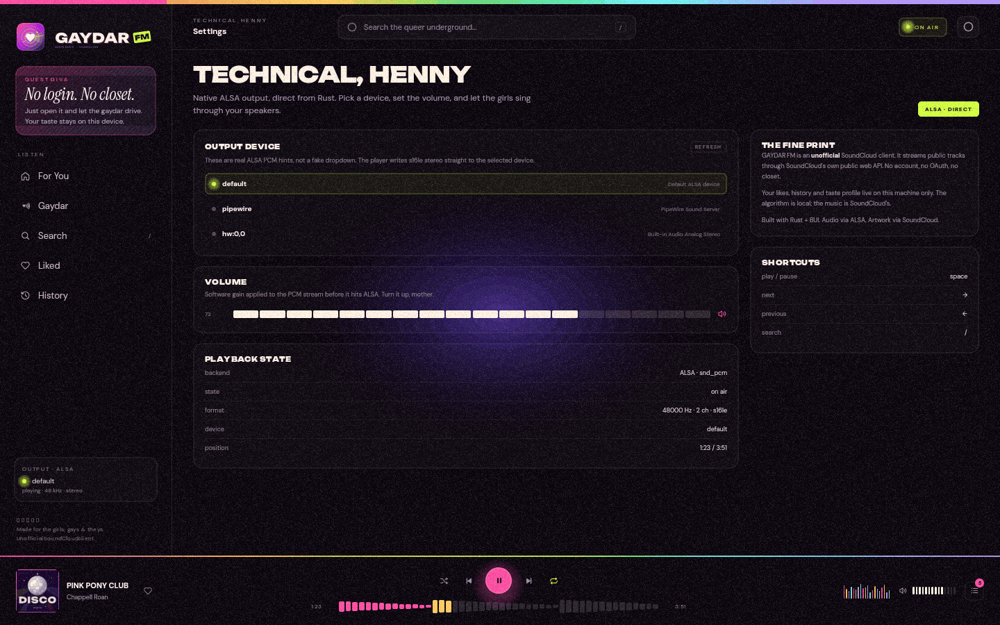

# GAYDAR FM

**A very queer SoundCloud radio for Linux. No login. No closet.**

GAYDAR FM is a native Rust desktop player built on [BUI](https://github.com/ppmpreetham/BUI) (`blenderui` 0.5). It talks to SoundCloud's public web API without an account, filters out every upload it cannot play without DRM, and turns what is left into a radio with four dials and an opinion. Audio is `ffmpeg` → ALSA. No web view, no Electron, no sign-in.

It is an unofficial client. It is also, deliberately, itself.

`v0.1.0` · Linux · Rust 1.88+ · GPL-3.0-or-later · [architecture](docs/ARCHITECTURE.md) · [troubleshooting](docs/TROUBLESHOOTING.md) · [development](docs/DEVELOPMENT.md)

---

## Screenshots

<p align="center">
  <a href="docs/gallery/01-home-1440x900.png"></a>
  <a href="docs/gallery/02-gaydar-1440x900.png"></a>
</p>
<p align="center"><sub><b>For You</b> — the hero, the stations, the queue. &nbsp;·&nbsp; <b>The Gaydar</b> — radar, dials, taste, and the read.</sub></p>

<p align="center">
  <a href="docs/gallery/07-now-playing-1440x900.png"></a>
  <a href="docs/gallery/03-search-1440x900.png"></a>
</p>
<p align="center"><sub><b>Now Serving</b> — artwork, waveform, visualiser, queue. &nbsp;·&nbsp; <b>Search</b> — dig through the crate.</sub></p>

<p align="center">
  <a href="docs/gallery/06-settings-1440x900.png"></a>
  <a href="docs/gallery/08-boot-1440x900.png"></a>
</p>
<p align="center"><sub><b>Settings</b> — real ALSA hints, not a fake dropdown. &nbsp;·&nbsp; <b>Boot</b> — tuning the Gaydar.</sub></p>

> The gallery is rendered headlessly; the exact generation loop is in [DEVELOPMENT.md](docs/DEVELOPMENT.md#5-screenshot-workflow). If an image is missing, regenerate it — it is a generated file, not a mockup. Liked and history are at [04-liked-1440x900.png](docs/gallery/04-liked-1440x900.png) and [05-history-1440x900.png](docs/gallery/05-history-1440x900.png); the full contact sheet is [contact-sheet.png](docs/gallery/contact-sheet.png).

---

## What it is

- A **native Linux radio** that streams real, public SoundCloud uploads through `ffmpeg` into **ALSA directly**. There is no browser engine in the playback path.
- A **playable-only client**: it keeps the minority of uploads that expose an unencrypted MP3 transcoding and drops the rest before they reach the queue.
- A **local recommender**: the Gaydar scores candidates from your tags, artists, dials, history, and a curated queer lexicon; every pick carries a human-readable reason.
- A **BUI application**: HTML-shaped layout and CSS, rendered by BUI's C kit into a native window. No webview, no JavaScript.

It is **not**: a SoundCloud replacement, a downloader, a DRM workaround, a social client, an offline player, or a promise that every track you love is playable. See [The honest SoundCloud caveat](#the-honest-soundcloud-caveat).

### The look

Aubergine ink, hot pink, acid lime, cyan, cream. **Unbounded** for the display type, **Instrument Serif Italic** for the editorial line, **DM Sans** for everything that has to be read. The icons and brand marks are original vector artwork, the grain is a real tile, and the layout is a drag poster that happens to have a queue. The full system is in [BRAND.md](docs/BRAND.md) and [assets/MANIFEST.md](assets/MANIFEST.md); the fonts are OFL.

---

## No login, no closet

There is no sign-in screen, no OAuth flow, no password field, and no account state anywhere in the app.

At startup the client fetches `https://soundcloud.com/`, extracts a **public web client ID** from the page or one of its JavaScript bundles, validates it with a real search request, and caches it. If SoundCloud rejects the ID with `401`/`403`, the client refreshes it once and retries. Three known public IDs are tried only if live extraction fails, and each one is validated before use. The details live in [`src/soundcloud.rs`](src/soundcloud.rs).

That ID is the same kind of public token a logged-out browser uses. It is **not your account**, and it grants no private data. The app's API calls are read-only public endpoints: search, track lookup, related tracks, artist uploads, the trending chart, the transcoding resolver, and artwork. It also fetches SoundCloud's public homepage and JavaScript bundles to discover the client ID. It does not follow, upload, comment, like on SoundCloud, or read your library.

"No closet" is the product's line, but it has a technical meaning too: there is no profile to fill in, no onboarding, no identity to declare, and no server-side taste profile. Likes, history, and the learned weights are plain JSON on this machine. Delete the data directory and it starts over with no taste memory.

---

## The honest SoundCloud caveat

**Only uploads with an unencrypted MP3 transcoding are playable.** Everything else is filtered out.

SoundCloud exposes several transcoding families per track. The ones this client can play are the MP3 family:

| Transcoding | Playable here? | Why |
| --- | --- | --- |
| `mp3_*` + `progressive` | Yes | Plain MP3 over HTTP; decoded by `ffmpeg`. |
| `mp3_*` + `hls` | Yes, if the playlist has no real encryption | Segmented MP3; the first bytes are checked for `#EXTM3U` and the absence of a real `#EXT-X-KEY`. |
| `aac_*` / `abr_*` | No | FairPlay/DRM-protected AAC or ABR. `ffmpeg` cannot open them without keys. |
| `snipped: true` | No | A preview, not the full upload. |
| policy `BLOCK` / `SNIP` | No | SoundCloud itself says the track is not available to this client. |
| non-streamable, under 45 s, or over 45 min | No | The queue's duration window. |
| obvious talk/podcast/interview/review or a slur-titled upload | No | A narrow music-likelihood filter, applied to list results. |

Two consequences:

1. **Search results are smaller than SoundCloud's own.** The client filters list responses to MP3-capable uploads; if a list item has no media object, it performs up to eight detail lookups before giving up.
2. **Major-label searches are often empty.** During a live run for this build on 2026-11-08, searches for *Rina Sawayama*, *Chappell Roan*, and *Kim Petras* returned **zero** MP3-playable results, while *"queer anthem"* returned **13–14 across runs**. That is the filter doing its job, not a search bug. Indie uploads, edits, bootlegs, and scene-tagged tracks are much more likely to play.

Stations are a primary curated search plus one fallback over the same filtered catalogue, not a guarantee of a full queue. Yield varies with what SoundCloud currently exposes as MP3; a station can return one track or none, and the UI reports that rather than padding with unplayable uploads. The queue also refills from a finite candidate pool, so a long session can exhaust it and need a retry or restart.

If a track is DRM-only, the app does not show a login prompt and does not try to circumvent the protection. It reports the track as unavailable and, for queue playback, skips it. **If you need every track on SoundCloud, this is not that app.** What it does play, it plays directly.

The client ID is a public web token, not a license. SoundCloud can rotate it, rate-limit it, or block a network. The client refreshes on rejection and backs off on `429`/server errors, but it cannot guarantee access forever.

---

## Features

| Area | What actually happens |
| --- | --- |
| **Catalogue** | Public SoundCloud search, related tracks, artist uploads, and the trending chart as a cold-start fallback. No account required. |
| **Playable filter** | MP3 progressive or unencrypted MP3 HLS only; non-streamable, `BLOCK`/`SNIP`, snipped previews, and tracks outside 45 s–45 min are dropped. A narrow music-likelihood filter also rejects obvious talk/podcast/interview/review uploads and slur-titled results. |
| **Verification** | Before a URL reaches the audio engine it is probed with a 2 KiB range request: MPEG frame sync/ID3 for progressive, `#EXTM3U` with no encrypted `EXT-X-KEY` for HLS. |
| **Audio** | `ffmpeg` decodes to `s16le`, stereo, 48 kHz (44.1 kHz fallback), written straight to ALSA. No `rodio`, no `cpal`, no PulseAudio API. |
| **Transport** | Play/pause, previous, next, waveform seek, software volume, queue drawer. Seeking respawns `ffmpeg` at the requested position. |
| **Device switching** | Pick a different ALSA PCM while playing; the stream restarts on the new device at the same position, preserving pause. |
| **Visualiser** | A 32-band analyser computed from the PCM in the audio thread. It is a meter, not an equaliser; it does not alter the sound. |
| **The Gaydar** | Four dials (Camp, Club, Soft, Chaos), tag/artist affinity, a queer lexicon, popularity, freshness, novelty, exploration, artist diversity, and a reason for every pick. |
| **Learning** | Plays, completions, skips, likes, and unlikes adjust tag and artist weights, persisted locally and decayed over time. |
| **Stations** | Four curated searches — Camp Classics, Ballroom 4AM, Soft Serve, Hyperpop Communion — each with a primary and a fallback query, applying their dials and starting a queue from whatever the MP3-only catalogue returns. |
| **Library** | Locally stored liked tracks and play history, plus the current queue. |
| **Artwork** | SoundCloud artwork normalised to 500 px, validated by magic bytes, cached on disk, reused if already valid. |
| **No-login bootstrap** | Client ID discovery, validation, disk cache, transparent refresh, and validated fallbacks. |
| **Demo + screenshots** | `--screenshot` renders every screen headlessly from demo data; `--demo` shows the same data in a window without network or audio. |

What is **not** here: audio downloads, offline playback, playlists, uploads, follows/comments, a system tray, MPRIS/media keys, gapless playback, crossfade, an equaliser, or shuffle/repeat behaviour (the icons are decorative in this build). See [Known rough edges](#known-rough-edges).

---

## Requirements

| Requirement | Why |
| --- | --- |
| **Linux** | The audio layer uses the ALSA API directly (`alsa` crate); this is not a cross-platform audio path. |
| **Rust 1.88+** | The crate uses edition 2024; BUI declares `rust-version = "1.88"`. Verified with Rust 1.98.1. |
| **C and C++ toolchain + CMake** | BUI builds its C kit with CMake and links `libstdc++`. `cargo` invokes this automatically. |
| **`pkg-config` + ALSA development headers** | `alsa-sys` needs `alsa.pc` and `alsa/asoundlib.h`. |
| **X11 development headers** | BUI compiles its native X11 window host only if `X11/Xlib.h` is found. Without them the build is headless-only. |
| **`ffmpeg` on `PATH` at runtime** | The audio engine spawns `ffmpeg` by name. It is not a build dependency. |
| **X11 runtime libraries** | For the visible window. BUI dlopen()s `libX11`; a Wayland session runs the window through XWayland. The GPU path needs a working OpenGL driver and falls back to software raster where no device exists. |
| **Network access** | To `soundcloud.com`, `api-v2.soundcloud.com`, `a-v2.sndcdn.com`, and the media/artwork CDNs. |

Install examples (package names as of 2026; adjust for your release):

**Debian / Ubuntu**

```bash
sudo apt install build-essential cmake pkg-config libasound2-dev libx11-dev ffmpeg
```

**Fedora**

```bash
sudo dnf install gcc gcc-c++ cmake pkgconf-pkg-config alsa-lib-devel libX11-devel ffmpeg
# If ffmpeg comes from RPM Fusion, install it from there; ffmpeg-free should cover MP3.
```

**Arch**

```bash
sudo pacman -S --needed base-devel cmake pkgconf alsa-lib libx11 ffmpeg
```

**openSUSE**

```bash
sudo zypper install gcc gcc-c++ cmake pkgconf-pkg-config alsa-devel libX11-devel ffmpeg
# ffmpeg is normally installed from Packman.
```

---

## Build and run

From the repository root:

```bash
cargo build --release
cargo run --release
```

The first build compiles BUI's C kit, so it needs CMake and a C++ compiler and takes longer than a pure-Rust crate. The built binary is `target/release/gaydar`.

Run it from the repository root so the app finds `assets/`. If you move the binary, point it at the assets explicitly:

```bash
GAYDAR_ASSETS_DIR=/path/to/gaydar/assets ./target/release/gaydar
```

The live app opens an X11 window (through XWayland on a Wayland session), discovers a client ID, starts the audio engine, and bootstraps the first queue. Until that finishes you see the **Tuning the gaydar** boot screen. If discovery fails, the boot screen shows the error and a retry button instead of pretending to be a library.

There is no `--help` in this build; unknown arguments are ignored. The CLI is deliberately small: `--screenshot`, `--live-shot`, `--screen`, `--width`, `--height`, `--demo`, and `--queue`.

---

## Install

### Debian / Ubuntu (.deb)

Every tagged release is built by GitHub Actions and attached to the [Releases](https://github.com/pkexecemre/gaydar-fm/releases) page as **.deb**, **.rpm**, and **.AppImage**.

~~~bash
# Debian / Ubuntu
sudo apt install ./gaydar-fm_0.1.2_amd64.deb
gaydar
~~~

The package installs the release binary, the full asset set, a freedesktop entry, and hicolor icons; `ffmpeg` and the ALSA/X11 runtime libraries are declared as dependencies. Remove it with `sudo apt remove gaydar-fm`. Build it locally with `packaging/build-deb.sh` (standard `ar`/`tar`, no Debian host required).

### Fedora / RHEL-family (.rpm)

~~~bash
sudo dnf install ./gaydar-fm-0.1.2-1.x86_64.rpm
gaydar
~~~

The RPM is built by the same CI job with [nfpm](https://nfpm.goreleaser.com/) (no `rpmbuild` needed) and bundles the binary, assets, desktop entry, and icons. It requires a `/usr/bin/ffmpeg` provider, ALSA, X11, and FreeType. Build it locally with `packaging/build-rpm.sh` after putting `nfpm` on `PATH` (the CI pins nfpm 2.48.0). Remove with `sudo dnf remove gaydar-fm`.

### Any modern Linux (.AppImage)

~~~bash
chmod +x GAYDAR-FM-0.1.2-x86_64.AppImage
./GAYDAR-FM-0.1.2-x86_64.AppImage
~~~

The AppImage bundles the app, assets, desktop entry, and icons; it needs a system `ffmpeg` and the usual X11/ALSA runtime libraries. Build it locally with `packaging/build-appimage.sh` (appimagetool + the type-2 runtime; the CI downloads both). If your distro lacks FUSE, run it with `--appimage-extract-and-run`.

### From source / prefix install

The repository ships a desktop packaging layer in [`packaging/`](packaging) — a prefix-aware installer, uninstaller, freedesktop entry, icons, and the `.deb` builder. It does not change the Rust sources or Cargo.toml.

~~~bash
# Build and install into $HOME/.local
./packaging/install.sh

# Explicit prefix
./packaging/install.sh --prefix=/opt/gaydar

# Use an existing target/release/gaydar
./packaging/install.sh --no-build

# Staged/package install; writes under /tmp/stage/usr
DESTDIR=/tmp/stage ./packaging/install.sh --prefix=/usr
~~~

The installer never invokes `sudo`. It installs:

- `PREFIX/bin/gaydar` — a launcher that sets `GAYDAR_ASSETS_DIR` and execs the real binary;
- `PREFIX/bin/gaydar.bin` — the compiled release ELF;
- `PREFIX/share/gaydar/assets/` — fonts, icons, brand marks, covers, patterns, stickers, seeds, licenses;
- `PREFIX/share/applications/gaydar.desktop`;
- `PREFIX/share/icons/hicolor/...` — SVG and 256 px PNG icons.

Remove the installed files with:

~~~bash
./packaging/uninstall.sh
./packaging/uninstall.sh --prefix=/opt/gaydar --dry-run
~~~

Neither script touches your library, settings, client ID cache, or artwork; those live under the XDG data/cache directories and are listed below. See [`packaging/README.md`](packaging/README.md) for the installed layout, `DESTDIR`, `CARGO_TARGET_DIR`, and the launcher's asset resolution.

---

## Screenshot mode

```bash
mkdir -p /tmp/gaydar-shots

# Default 1440×900, Home, demo data
cargo run --release -- --screenshot /tmp/gaydar-shots/home.png --screen home

# A different screen and size
cargo run --release -- --screenshot /tmp/gaydar-shots/now.png --screen now --width 1280 --height 800

# Boot screen
cargo run --release -- --screenshot /tmp/gaydar-shots/boot.png --screen boot

# Home with the queue drawer open
cargo run --release -- --screenshot /tmp/gaydar-shots/queue.png --screen home --queue
```

`--screen` accepts:

| Value | Screen |
| --- | --- |
| `home` (default) | For You |
| `gaydar` | The Gaydar |
| `search` | Search |
| `liked` | Liked / The Canon |
| `history` | History / Already Served |
| `settings` | Settings |
| `now` (or `nowplaying`) | Now Serving |
| `boot` | The boot screen (forces the booting state) |

Unknown names fall back to Home. `--width` and `--height` are floats in CSS pixels; the default is 1440×900. The visible window declares a 1120×720 minimum; the headless path uses the requested size regardless (1000×600 is verified).

`--screenshot` uses `Application::headless()`: **no window, no GPU, no audio device, no network**. It builds a demo state with twelve tracks, a queue, likes, history, and fake levels, then renders one frame to a PNG. That makes it deterministic enough for a gallery and useful on a build machine, but it is not evidence that SoundCloud or your speakers are working. For that, run the real app or the live tests.

### Live screenshots

`--live-shot PATH` is the live counterpart: it runs the real app headlessly, waits up to 45 seconds for `PlaybackState::Playing` (and up to 5 seconds more for artwork), then writes the frame. It needs network, `ffmpeg`, and an ALSA device; use `GAYDAR_ALSA_DEVICE=null` for a silent run. Unlike `--screenshot`, it does not use demo data. With `--screen now` it switches to Now Serving before capturing.

~~~bash
GAYDAR_ALSA_DEVICE=null cargo run --release -- --live-shot /tmp/gaydar-live.png --screen now
~~~

If playback never starts within the deadline, it still writes a frame, logs `live screenshot (not playing)`, and exits 0. Check the start page/error state rather than treating that file as a playback success.

`--queue` opens the queue drawer at launch. It combines naturally with `--screenshot` or `--live-shot` and with `--demo`, and it is also valid in a live launch (the drawer opens once the window exists).

`--demo` is the visible-window equivalent: `cargo run --release -- --demo --screen gaydar` opens the BUI window with demo data and no SoundCloud or audio engine. It is useful for UI work without a network, but it still needs a display.

---

## Audio and ALSA devices

The Settings screen lists real ALSA playback hints in a scrollable list, with **default** first and de-duplicated by PCM name. **REFRESH** re-enumerates the hints. In the live app, selecting one saves it to `settings.json` and, if something is playing, restarts the stream on the new device at the current position (paused stays paused).

You can also choose the device for one launch:

```bash
GAYDAR_ALSA_DEVICE=default cargo run --release
GAYDAR_ALSA_DEVICE=pipewire cargo run --release
GAYDAR_ALSA_DEVICE=plughw:0,0 cargo run --release
GAYDAR_ALSA_DEVICE=hw:0,0 cargo run --release
```

The environment variable is applied at startup and overrides the stored device for that run. The stored device is used again next time unless the variable is set again.

What the engine asks ALSA for:

- `s16le` (signed 16-bit little-endian), **stereo**, interleaved access.
- **48 kHz first**, then **44.1 kHz**. If the device negotiates a different rate, that rate is rejected and the next one is tried.
- Period `512` frames, buffer at least `2048` frames.
- Playback is paced by the ALSA delay so a fast sink does not race ahead of real time.

Notes that matter in practice:

- `default` is an ALSA plugin, not necessarily your analog output. On a machine with HDMI and USB audio it can point somewhere surprising. Pick the real device in Settings, or use `hw:`/`plughw:`.
- `hw:` is the hardware device and may be exclusive; `plughw:` lets ALSA convert format/rate, and `default`/`pipewire`/`pulse` go through the sound server if one is configured.
- **Volume is software gain** applied to the PCM before ALSA, squared for a more natural taper. It is not a hardware mixer and it is not bit-perfect. Your system mixer still applies.
- The 32-band meter is analysis only. There is no EQ in the signal path.
- Audio errors appear in the UI and on stderr as `[gaydar audio] …`; the error often includes the tail of `ffmpeg`'s stderr.

More diagnosis: [TROUBLESHOOTING.md § No audio](docs/TROUBLESHOOTING.md#no-audio).

---

## Where your data lives

GAYDAR FM keeps a handful of local files. All of them are plain JSON or images; none of them is uploaded.

| Data | Default path (Linux) | Override |
| --- | --- | --- |
| Device + volume | `$XDG_DATA_HOME/gaydar/settings.json` (usually `~/.local/share/gaydar/settings.json`) | `GAYDAR_DATA_DIR` → `$GAYDAR_DATA_DIR/settings.json` |
| Taste state | `$XDG_DATA_HOME/gaydar/state.json` plus `state.json.bak` and occasional `.corrupt-<unix>` files | `GAYDAR_DATA_DIR` → `$GAYDAR_DATA_DIR/state.json` |
| Client ID cache | `$XDG_CACHE_HOME/gaydar/client_id.json` (usually `~/.cache/gaydar/client_id.json`) | `GAYDAR_CACHE_DIR` → `$GAYDAR_CACHE_DIR/client_id.json` |
| Artwork cache | `$XDG_CACHE_HOME/gaydar/art/<track_id>.jpg` | `GAYDAR_CACHE_DIR` → `$GAYDAR_CACHE_DIR/<track_id>.jpg` |

`GAYDAR_DATA_DIR` and `GAYDAR_CACHE_DIR` are used **as given** — the app does not append another `gaydar` component. If you set `GAYDAR_CACHE_DIR`, the client ID file and artwork share that directory. That is the intended behaviour of the override, not a bug, but it is different from the default layout.

The taste state contains:

- `liked`: up to 500 liked tracks.
- `history`: up to 300 entries with track, `played_at`, `fraction`, and `outcome` (`started`, `completed`, `skipped`).
- `tag_weights` / `artist_weights`: learned affinities, clamped to ±10 and pruned when large.
- `skipped`: up to 3000 track ids.
- `dials`: Camp, Club, Soft, Chaos.
- `plays`, `completions`, `version`, `last_updated`.

Writes are atomic (temporary file + rename). The state save keeps the previous file as `state.json.bak`; a corrupt file is renamed to `state.json.corrupt-<unix>` and the backup is tried. There is **no inter-process lock**: running two copies against the same data directory is last-writer-wins. Don't do that.

To reset taste without deleting it permanently:

```bash
mv ~/.local/share/gaydar/state.json ~/.local/share/gaydar/state.json.old
```

To wipe everything (stop the app first):

```bash
mv ~/.local/share/gaydar ~/.local/share/gaydar.old
rm -rf ~/.cache/gaydar
```

---

## Controls

| Where | Action | What it does |
| --- | --- | --- |
| Sidebar | **For You / Gaydar / Search / Liked / History** | Switch screens. |
| Top bar | Search field, gear | Open Search; open Settings. |
| Home | **START THE RADIO / PAUSE** | Live: bootstrap the radio if idle, otherwise toggle play/pause. Demo: toggle the simulated transport. |
| Home | **TUNE THE GAYDAR** | Open the Gaydar screen. |
| Home | Station card | Live: apply the dials, search the primary query, then the fallback if needed, and start the queue. Demo: apply the dials and play a demo track (or the first one). |
| Home | **VIEW ALL**, **TUNE IT**, **SCOPE** | Open the Gaydar (VIEW ALL/TUNE IT) or Search (SCOPE). |
| Home | Track row, mini card, heart | Play a track; like/unlike it. |
| Player | Artwork | Open **Now Serving**. |
| Player | Previous / play / next | Transport. Previous restarts the current track if past 3 s; otherwise it goes back in history. |
| Player | Waveform | Seek to the clicked segment. |
| Player | Volume bars | Set software volume. |
| Player | Queue button | Open the queue drawer. Click a row to play it; click the scrim or close to dismiss. |
| Now Serving | Back, heart, play, next, waveform, queue rows | Same transport and library actions, larger. |
| Search | Field | Click to focus; type; **Enter** submits; **Esc** clears the query; **Backspace** deletes. Results are fetched on submit in live mode, not while typing. |
| Search | Suggestion chips | Fill the field and search immediately. |
| Gaydar | Four dials | Each has 18 clickable segments (0–1). Live: sends the new dials to the engine. Demo: local only. |
| Settings | Device rows | Select an ALSA PCM; a playing stream restarts on it at the same position. |
| Settings | **REFRESH** | Re-enumerate ALSA playback hints. |
| Settings | Volume bars | Set software volume; saved to `settings.json`. |

### Keyboard

Global keys work on the app shell (after boot) when the search field does **not** have focus:

| Key | Action |
| --- | --- |
| **Space** | Play/pause. |
| **→** | Next track. |
| **←** | Previous track. |
| **/** | Jump to Search. |
| **Q** | Toggle the queue drawer (not on Now Serving). |
| **L** | Like/unlike the current track. |
| **Esc** | Close the queue, leave Now Serving, or dismiss the error banner, in that order. |

The search field consumes its own keys: typing, **Backspace**, **Enter** to submit, **Esc** to clear the query. While it is focused, the global keys above are suppressed. The Settings **SHORTCUTS** card lists the transport and search keys; Q, L, and Esc also work but are not listed there.

---

## How the Gaydar works

The engine is a transparent scorer, not a neural network and not a cloud service. It lives in [`src/gaydar.rs`](src/gaydar.rs); a fuller treatment is in [ARCHITECTURE.md](docs/ARCHITECTURE.md#4-the-recommendation-engine).

1. **Build a candidate pool.** Bootstrap runs up to four seed queries in parallel: your strongest artist if its weight is above 1.2, your strongest tag if above 0.8, one random artist from the built-in list, and `"queer anthem"`; if those do not fill four slots, weighted picks from the scene seeds do. Refills — when they run — use related tracks, artist uploads, learned tags, one weighted random exploration query, and a fallback search. Results are normalised, deduplicated, and filtered by the playable rules above.
2. **Score each candidate.** Every term is bounded; the score is clamped to `0.0..=3.0`:

   ```text
   score = 0.42
         + 0.30 · tag_affinity
         + 0.24 · artist_affinity
         + 0.20 · queer_signal
         + 0.07 · popularity
         + 0.10 · freshness
         + 0.20 · (dial_fit − 0.35)
         + source_bonus
         + unseen_artist_bonus
         + exploration_bonus
         + jitter
         − long_form_penalty
         − 0.055 · recent_artist_count
   ```

   - `tag_affinity` = `tanh(sum(tag_weights) / (4 · √tag_count))` over the track's tags plus its genre, where `tag_count` is how many of those tags already have a weight.
   - `artist_affinity` = `tanh(artist_weight / 4)`.
   - `queer_signal` = `1 − e^(−0.75·strong − 0.25·mild)`, plus `0.55` when the artist is one of the built-in queer anchors, clamped to `0..1`.
   - `popularity` = `0.7·log10(1+plays)/6.5 + 0.2·log10(1+likes)/5 + 0.1·log10(1+followers)/6`.
   - `freshness` = `e^(−age_days / 540)`.
   - `dial_fit` is the dial-weighted sum of Camp/Club/Soft/Chaos keyword scores, divided by the sum of the four dials plus 0.001.
   - `source_bonus`: seed 0, related +0.12, artist +0.06, tag +0.05, chart +0.03.
   - `unseen_artist_bonus` = +0.05 for an artist the engine has never seen.
   - Exploration: with probability `0.06 + 0.18·chaos`, add `0.02..0.14`; jitter is `±0.025`.
   - `long_form_penalty` = 0.12 above 15 minutes; `recent_artist_count` is the count in the last 12 history entries.
3. **Pick with diversity.** Sort by score, cap how many tracks one artist can take (normally one when there are enough distinct artists), then fill any remaining slots from the sorted list. Picks are removed from the pool and remembered as served.
4. **Explain the pick.** The reason comes from real signals: `certified ballroom`, `because you keep replaying <artist>`, `more <tag> in your veins`, `more like <artist>`, `camp canon`, `soft sapphic detour`, `chaos dial, no notes`, `fresh out the group chat`, `the gaydar says explore`, `right on the dial`, a source-based line, or a genre line. It is chosen for the track, not templated after the fact.
5. **Learn.** A play adds `+0.18` to tags and `+0.12` to the artist; a completion `+1.4`/`+1.2`; a skip under 35% `−1.8`/`−1.4` (later skips only `−0.15`/`−0.1`); a like `+2.6`/`+2.2`; an unlike `−1.4`/`−1.2`. Tag deltas are spread across the track's tags by `√count`. Weights are clamped to ±10, pruned when they grow too large, and decayed over time by `0.99^(days/7)` (capped).
6. **Verify the cold start.** Before the first queue is returned, the first up to three picks are resolved in parallel with a hard deadline. Confirmed tracks move to the front; DRM-only or withdrawn tracks are normally dropped; transient failures stay in the queue for a later retry.

The four dials are not a filter. They change the keyword fit, the exploration rate, and the seed weights; the station presets set them for you:

| Dial | Default | What it reads |
| --- | --- | --- |
| Camp | 0.82 | camp, kitsch, diva, drag, disco, musical, Eurovision, bubblegum, cabaret… |
| Club | 0.74 | club, house, techno, rave, ballroom, vogue, trance, warehouse, 4am… |
| Soft | 0.46 | soft, ambient, ballad, dream pop, R&B, folk, intimate, bedroom pop… |
| Chaos | 0.38 | experimental, glitch, breakcore, hyperpop, industrial, deconstructed… |

The stations apply their own values: Camp Classics `1.0/0.55/0.30/0.45`, Ballroom 4AM `0.82/1.0/0.18/0.62`, Soft Serve `0.35/0.28/1.0/0.20`, Hyperpop Communion `0.68/0.86/0.25/1.0`.

Everything the engine learns is local JSON. There is no embedding service, no remote model, and no taste profile stored on a server. The search queries it derives from that taste are still requests to SoundCloud and are visible there.

---

## Architecture at a glance

```text
                         RadioCommand
   ┌──────────────┐  ───────────────────▶  ┌──────────────────────┐  ── HTTPS ──▶ SoundCloud
   │  UI thread   │                        │  gaydar-radio thread │              API / CDN
   │  GaydarApp   │  ◀───────────────────  │  SoundCloudClient    │
   │  BUI render  │      RadioEvent        │  GaydarEngine        │
   │              │                        └──────────────────────┘
   │              │
   │              │      AudioCommand       ┌──────────────────────┐
   │              │  ───────────────────▶  │  gaydar-audio thread │  ── s16le ──▶ ALSA
   │              │                        │  ffmpeg child        │
   └──────────────┘  ◀───────────────────  │  PCM + level meter   │  ◀── stdout ── ffmpeg
                         AudioStatus        └──────────────────────┘
```

- The **UI thread** never blocks on the network or ALSA. It sends `RadioCommand` and `AudioCommand` over mpsc channels and drains events at the start of each render; the only bounded queue is the ffmpeg chunk channel.
- The **radio worker** owns the SoundCloud client and the recommender. It pushes `RadioEvent`s into a shared queue and wakes BUI with `UiSender`.
- The **audio worker** owns the ALSA PCM handle and the `ffmpeg` child. A reader thread turns stdout into 4 KiB chunks; a bounded channel provides backpressure; only the worker touches ALSA.
- **Artwork** is fetched on the radio worker, validated, written atomically, and handed back as a path for BUI's `img`.

Full module map, threading, Mermaid diagrams, the endpoint list, the audio state machine, and the JSON schema: [docs/ARCHITECTURE.md](docs/ARCHITECTURE.md).

---

## Privacy

- **No account, no OAuth, no cookie jar, no login token.** The client ID is a public web token cached locally.
- **No telemetry, analytics, crash reporting, or update check.** The only network destinations are SoundCloud's web page, its JS bundle host, `api-v2.soundcloud.com`, artwork hosts, and the media CDN URLs SoundCloud returns.
- **Your stored history, likes, skips, dials, and weights are local JSON.** The recommendation engine runs in-process. It does send SoundCloud search queries derived from that taste (a top artist or tag, for example), so those queries are visible to SoundCloud like any search. Nothing is uploaded as a profile.
- SoundCloud still sees the requests a logged-out browser would make: your IP, a Chrome user agent, and the relevant `Origin`/`Referer` headers. This app does not hide that, and does not claim to.
- The app writes nothing to a log file. Runtime errors go to stderr (`[gaydar audio]`, `[gaydar radio]`) and to the UI.
- Deleting the data and cache directories removes the taste profile, settings, cached client ID, and artwork. See [Where your data lives](#where-your-data-lives).

---

## Testing and project status

Verified on this checkout on **2026-11-08**, on Linux with Rust 1.98.1, CMake 4.4.4, ffmpeg 9.0.2, and ALSA 1.2.16.1:

| Check | Command | Result |
| --- | --- | --- |
| Release build | `cargo build --release` | OK |
| Unit tests | `cargo test --lib` | 4 passed |
| Headless UI interaction | `cargo test --test ui_interactions` | 1 passed |
| Live SoundCloud integration | `cargo test --test live_soundcloud -- --nocapture` | 5 passed, 1 ignored |
| Client ID rotation (ignored) | `cargo test --test live_soundcloud -- --ignored live_client_id_refresh_on_401 --nocapture` | 1 passed when run explicitly |
| Live headless E2E (ignored) | `E2E_DIR=$(mktemp -d); GAYDAR_ALSA_DEVICE=null GAYDAR_DATA_DIR="$E2E_DIR/data" GAYDAR_CACHE_DIR="$E2E_DIR/cache" cargo test --test live_app_headless -- --ignored --nocapture` | 1 passed when run explicitly |
| Live screenshot | `GAYDAR_ALSA_DEVICE=null cargo run --release -- --live-shot /tmp/live.png --screen now` | PNG, `playing: true` |
| Screenshot matrix | eight `--screenshot` runs, one per screen | 8 PNGs at 1440×900 |
| Packaging | `./packaging/install.sh --prefix /tmp/gaydar-install --no-build; ./packaging/uninstall.sh --prefix /tmp/gaydar-install --dry-run` | staged install OK |

The live tests need internet access to SoundCloud and are inherently flaky: they validate client ID discovery, search, MP3/HLS resolution, artwork download, a DRM-only error path, bootstrap, taste learning, state round-trip, corrupted-state recovery, and refill exclusions. The headless E2E target is a separate opt-in test: it boots the real app, resolves a track, plays and seeks, advances to the next track, likes it, searches, starts a station, and verifies a natural finish advances the queue. Run them when you touch the network, streaming, or engine code. The ignored test exercises client ID rotation:

```bash
cargo test --test live_soundcloud -- --ignored live_client_id_refresh_on_401 --nocapture
```

The GitHub Actions workflow in [.github/workflows/release.yml](.github/workflows/release.yml) builds the Debian package on every v* tag and uploads it to that release. Live network tests stay local and are not part of the release job.

### Known rough edges

These are real in the current build and are documented rather than hidden:

- The shuffle and repeat icons are decorative; there is no shuffle/repeat behaviour.
- Station yield is catalogue-limited: each station tries a primary and one fallback search (limit 50 each) and can still return very few or no MP3-playable tracks. The UI reports it instead of padding the queue.
- The tree is **not rustfmt-clean** and has existing clippy warnings; see [DEVELOPMENT.md](docs/DEVELOPMENT.md#6-code-style-and-checks).
- `assets/seeds.json` is brand/seed reference data; the running engine uses the hard-coded seed lists in [`src/gaydar.rs`](src/gaydar.rs), not that JSON file.
- Unit coverage is thin outside `soundcloud.rs`; the recommendation and audio layers are exercised by the live integration tests.

---

## Troubleshooting

| Symptom | Start here |
| --- | --- |
| No sound, or the wrong output device | [No audio](docs/TROUBLESHOOTING.md#no-audio) |
| Search returns nothing | [No search results](docs/TROUBLESHOOTING.md#no-search-results) |
| `401`, `403`, or "SoundCloud rejected the client id" | [Client ID rejected](docs/TROUBLESHOOTING.md#client-id-rejected-401403) |
| Only label tracks, zero playable results | [No MP3 tracks](docs/TROUBLESHOOTING.md#no-mp3-tracks) |
| Headless screenshot is blank or fails | [Headless screenshot](docs/TROUBLESHOOTING.md#headless-screenshot) |
| CMake, ALSA, or X11 build errors | [Build fails](docs/TROUBLESHOOTING.md#build-fails) |
| Window will not open / GPU trouble | [The window won't open](docs/TROUBLESHOOTING.md#the-window-wont-open) |

---

## Licensing and credits

**GAYDAR FM is licensed under GPL-3.0-or-later.** [BUI](https://github.com/ppmpreetham/BUI) is GPL-3.0-or-later, and linking it produces a combined work under the same license. The crate metadata in [`Cargo.toml`](Cargo.toml) declares it.

- **Fonts:** Unbounded, Instrument Serif, and DM Sans are under the **SIL Open Font License 1.1**. The verbatim licenses ship in [`assets/fonts/unbounded/OFL.txt`](assets/fonts/unbounded/OFL.txt), [`assets/fonts/instrument-serif/OFL.txt`](assets/fonts/instrument-serif/OFL.txt), and [`assets/fonts/dm-sans/OFL.txt`](assets/fonts/dm-sans/OFL.txt). They are not sold separately.
- **Artwork:** the icons, brand marks, stickers, covers, and patterns in `assets/` are original work released with the project under GPL-3.0-or-later, per [`assets/MANIFEST.md`](assets/MANIFEST.md).
- **SoundCloud:** GAYDAR FM is an **unofficial** client. It is not affiliated with, endorsed by, or sponsored by SoundCloud. "SoundCloud" and its marks belong to SoundCloud. Track audio, metadata, and artwork belong to their uploaders and rights holders. The app uses public, read-only endpoints and does not circumvent DRM; use of the API is subject to SoundCloud's terms.

The GPLv3 text is in [LICENSE](LICENSE). If you distribute a binary, ship that text and the corresponding source, as the license requires.

The visual system has its own documents: [`docs/BRAND.md`](docs/BRAND.md), [`docs/COPY.md`](docs/COPY.md), and [`docs/BUI-NOTES.md`](docs/BUI-NOTES.md). The asset inventory is [`assets/MANIFEST.md`](assets/MANIFEST.md).

---

## Contributing

Contributions are welcome, especially around playable-stream coverage, ALSA edge cases, the recommender's explanations, and accessibility.

1. Read [DEVELOPMENT.md](docs/DEVELOPMENT.md) for the module map, test commands, and the constraints that keep the UI non-blocking.
2. Read [BRAND.md](docs/BRAND.md) before changing copy or colours. The voice is specific, warm at the centre, sharp at the edges, and never punches down.
3. Keep the playable filter honest: MP3 only, no DRM workarounds, no login. If a change makes a DRM-only track reach `ffmpeg`, it is a regression.
4. Run the unit and headless UI tests at minimum; run the live tests if you touched SoundCloud, streaming, or the engine. Run `rustfmt --edition 2024` on files you change (a bare `cargo fmt` reformats the whole unformatted tree) and keep the BUI fake-browser constraints in mind.
5. Do not commit cached client IDs, personal state, screenshots of your own listening history, or anything from `~/.local/share/gaydar` / `~/.cache/gaydar`.

There is no CLA. Contributions are accepted under GPL-3.0-or-later.

---

<p align="center"><sub>Made for the girls, gays & theys. Unofficial SoundCloud client. No login. No closet.</sub></p>
