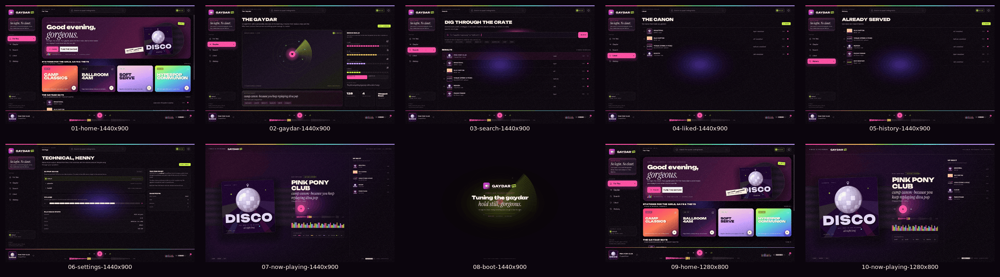

# GAYDAR FM — visual QA gallery

Headless demo captures of the production UI. Generated from the release binary on
2026-11-08 (Europe/Istanbul; source tree 22:34, gallery run 22:51) with the bundled
fonts and covers in `assets/`.
No application source was edited for this gallery.



## What was captured

| # | File | Viewport | Screen |
| --- | --- | --- | --- |
| 01 | [01-home-1440x900.png](01-home-1440x900.png) | 1440x900 | Home / For You |
| 02 | [02-gaydar-1440x900.png](02-gaydar-1440x900.png) | 1440x900 | The Gaydar |
| 03 | [03-search-1440x900.png](03-search-1440x900.png) | 1440x900 | Search |
| 04 | [04-liked-1440x900.png](04-liked-1440x900.png) | 1440x900 | Liked / The Canon |
| 05 | [05-history-1440x900.png](05-history-1440x900.png) | 1440x900 | History / Already Served |
| 06 | [06-settings-1440x900.png](06-settings-1440x900.png) | 1440x900 | Settings |
| 07 | [07-now-playing-1440x900.png](07-now-playing-1440x900.png) | 1440x900 | Now Playing |
| 08 | [08-boot-1440x900.png](08-boot-1440x900.png) | 1440x900 | Boot |
| 09 | [09-home-1280x800.png](09-home-1280x800.png) | 1280x800 | Home (responsive squeeze) |
| 10 | [10-now-playing-1280x800.png](10-now-playing-1280x800.png) | 1280x800 | Now Playing (responsive squeeze) |
| 11 | [11-queue-1440x900.png](11-queue-1440x900.png) | 1440x900 | Queue drawer (extra, `--queue`) |

The queue drawer is an overlay rather than one of the eight base screens, so it is
captured separately and is not in the 10-frame contact sheet.

README-compatible symlinks are generated next to the numbered files:
`home.png`, `gaydar.png`, `search.png`, `liked.png`, `history.png`,
`settings.png`, `now.png`, `now-playing.png`, `boot.png`, `queue.png`.

## Reproduction

```bash
cd /home/emre/Projeler/gaydar
./scripts/gaydar-screenshots.sh
```

The script builds the release binary once and then calls the same CLI that
`cargo run --release` would use:

```text
target/release/gaydar --screenshot OUT.png --screen SCREEN --width W --height H
```

It uses `GAYDAR_ASSETS_DIR=assets`, captures to a temporary directory, verifies
dimensions, then writes PNGs to `docs/gallery`. PNGs are quantized with
`pngquant --quality=70-90` when available; ImageMagick is used only for the
contact sheet. The 10 base images total roughly 3.9 MB (decimal); every image is
1440x900 or 1280x800 and non-empty.

Capture caveat: screenshot mode draws one headless frame at the virtual clock
origin. Motion is therefore a still: the radar sweep, equalizers and the boot
progress shimmer are frozen at their initial phase. This is also why the boot
progress bar reads as a short sliver rather than a moving fill.

## Screen verdicts

### Home (01, 09)
The strongest screen. The aubergine/pink hero, Unbounded headline, Instrument
Serif italic phrase and the four station cards read as one drag-poster system.
The 1280 breakpoint now reduces the rail to 232 px, the hero title to 40 px and
the station cards to 190 px; **all four station names, including HYPERPOP
COMMUNION, fit at 1280** and the card footers/play buttons remain visible.
What is still visibly wrong:

- **The current track and its artwork disagree.** The hero cover, player art,
  search row and now-playing art show the branded **DISCO** cover, while the
  title is **PINK PONY CLUB** (Chappell Roan). The hero meta and player meta
  both correctly say PINK PONY CLUB, which makes the DISCO wordmark look like a
  bug rather than a mood cover.
- **At 1280 the GAYDAR CERTIFIED sticker overlaps the cover.** The sticker
  (`x≈812–965, y≈307–345`) covers the leading **D** of the cover's DISCO
  wordmark (cover `x≈902–1120, y≈157–375`). At 1440 the same sticker sits left
  of the cover with a 7 px gap, so this is a responsive collision only.
- **The recommendation list is cut by the fixed player.** At 1440 the player
  starts at `y=800`; the "THE GAYDAR SAYS" block starts around `y=720`, the
  first row is readable and the second row (SILK CHIFFON, around `y=793`) is
  chopped at the player edge. At 1280 the player starts at `y=704`, the section
  heading and subtitle are visible, and only the top of the first row
  (IMMATERIAL) remains before the cut. The page is scrollable, but the initial
  frame hides the adaptive recommendation, which is one of the product's main
  ideas.

### The Gaydar (02)
The radar, four dials, reason card and stats form a coherent "instrument panel".
The dial values (82/74/46/38), segment meters and serif "CURRENT READ" line are
aligned and readable. The two-column lower row ends at different heights (reason
card to `y≈770`, stat cards to `y≈738`); this is an imbalance, not a clipping
bug. "CAMP IT UP" is deliberately quiet but still legible. No overflow found.

### Search (03)
The custom field, chips, section header and six result rows fit cleanly. The
active row is marked by a pink tint and a ▶ index; covers and hearts align.
Remaining issues:
- **The custom search field has no visible focus treatment.** A focused-state
  probe (click at `x≈802, y≈227`) confirms logical focus, but the 1 px border
  stays at `rgba(255,255,255,.16)` instead of turning pink and no 3 px glow
  appears. `.fancy-search:focus` is defined at `src/extra.rs:233`, but the
  focused element is a div (`src/views.rs:336`), not a focusable input.
- The pink caret is rendered unconditionally (`src/views.rs:340`), so the
  field looks focused even in the demo frame where it is not.
- The demo fallback assigns the DISCO cover to PINK PONY CLUB (same mapping as
  the hero/player).
- When the query is narrowed to one result the result count reads
  **"1 TRACKS · SOUNDCLOUD"** (`src/views.rs:469` always uses the plural).

### Liked / History (04, 05)
Both lists are clean: 42 px covers, readable titles, right-aligned durations,
filled/outline hearts matching the data, and no text clipping. Liked has four
tracks and History five; their chips are accurate. The lower two-thirds of both
pages are empty. That is a composition weakness rather than a rendering bug,
but the Canon and Already Served screens feel under-designed next to Home/Gaydar.
The current player still shows DISCO next to PINK PONY CLUB.

Empty states (checked with an interaction probe, not in this gallery): the
"NOTHING BUT DUST", "THE CANON IS EMPTY" and "A FRESH START" states are
on-brand and centered. They do expose a 1 px default scrollbar on the otherwise
empty content area, because the empty block is `height:100%` with extra
padding; it is the least-styled control in the app.

### Settings (06)
The clearest information screen. Device rows, selected ALSA device, segmented
volume, the three playback-state rows and the fine print all fit; the speaker
icon sits inside the card. "REFRESH" and the shortcut keys are quiet but
legible. No clipping, no collisions. The right column ends at `y≈514`, leaving
a large empty lower-right quadrant, which is acceptable for a settings page.

### Now Playing (07, 10)
The immersive composition reads: 400 px cover, display title, serif reason,
transport, 56-bar seek, 48-bar visualizer, readings strip and Up Next queue.
The new VOL bars and ALSA label sit correctly at the bottom right. The queue
rows, durations and reason lines fit at both sizes, and the 1280 header does not
clip.

Remaining issues:
- **The cover is DISCO but the track is PINK PONY CLUB** (`x≈122–532, y≈279–690`
  at 1440; `x≈86–500, y≈222–620` at 1280). This is the same fallback mapping.
- **The reading strip collapses at 1280.** At 1440 the four bars are roughly
  28–31 px and read as meters (`x≈650–1062`). At 1280 the info column is
  `x≈590–895`; the fixed 30 px label and 17 px value leave only a few pixels
  for each track, so the bars become 2–8 px stubs while the labels and values
  remain. The strip still aligns, but no longer communicates a value visually.
  A 2x2 grid or hiding the track below the label at `<=1320` would fix it.
- The player art is not visible on this screen by design; the same DISCO cover
  is used in the queue thumbnails and on the Home player.

### Boot (08)
The background word has been removed and the orbit is dimmed, so the centered
brand/title is much cleaner. The boot wordmark and "Tuning the gaydar" are
legible. Remaining issues:
- The boot progress fill is only a short 42 px sliver (`x≈631–672`) at the
  captured frame because the fill is mid-`bootshimmer`; with a single headless
  draw the still looks under-filled. If a fuller bar is wanted for the gallery,
  advance the virtual clock before capture in `src/main.rs`.
- The footer "RUST + BUI · ALSA DIRECT · YOUR TASTE STAYS LOCAL" is 7 px
  `#5d4c65` on `#0b050d`: **2.58:1**, effectively unreadable at 1440.
- Inactive steps "02 STREAM" and "03 SERVING" are `#6e5f75`: **3.41:1** at 7 px.
- The wordmark subline under GAYDAR FM (inside the SVG and repeated in the rail)
  is only a few pixels high and reads as noise at this scale.

### Queue drawer (11)
The new drawer is a clean 396 px overlay: scrim, title, count, five rows with
covers, reasons and durations, close button and footer all fit at 1440. It also
fits at 1280 with no clipped rows (checked separately). The drawer is a real
improvement and needs no layout fix. Its 7 px count/footer inherit the microtype
contrast concern below.

## What works

- The brand system is consistent across nine screens: aubergine/ink, hot pink,
  lime, cyan, cream; Unbounded display type; Instrument Serif italic; DM Sans
  body. The logo mark and GAYDAR wordmark are legible at 20 px; the FM sticker
  is clear.
- The active pink nav item, ghosted icons, guest-diva card, ALSA mini card and
  footer create a convincing left rail.
- The radar, mood dials, reason card and stat cards make the algorithm visible
  rather than hiding it behind a black box.
- Search, liked and history share a coherent list/track-row system; the custom
  field, chips and hearts are styled consistently.
- The player is a proper flex sibling and reserves its 100 px; no true
  player/panel overlap was found on any captured screen.
- At 1280 the responsive breakpoint now works for station names and headers:
  HYPERPOP COMMUNION fits, the hero title shrinks to 40 px, and the player
  title/artist are not truncated.
- Branded SVG covers render sharply in the queue/rows/hero/now art (the
  mapping caveat above notwithstanding), and the queue drawer is functional.
- The segmented waveform and volume bars are styled, clickable and visually
  consistent; progress fill at 1:23 / 3:51 is proportionally correct.
- Boot no longer has the giant background word; the orbit is dimmed and the
  composition is calmer.

## Remaining visual bugs, prioritized

| Priority | Finding | Evidence |
| --- | --- | --- |
| P1 | **Search field has no visible focus state.** Logical focus works; the border/glow does not change. The caret is always drawn, so it cannot be used as a focus cue. | 03-search-1440x900.png; focus probe `[x300–1304, y205–249]`; `src/extra.rs:233`, `src/views.rs:336,340` |
| P1 | **1280 hero sticker covers the cover wordmark.** The GAYDAR CERTIFIED sticker overlaps the leading D of DISCO at 1280; at 1440 it does not. | 09-home-1280x800.png; sticker `x≈812–965, y≈307–345`, cover `x≈902–1120`; `src/theme.rs:222,239` |
| P1 | **The adaptive recommendation list is cut by the player.** At 1440 row 2 (SILK CHIFFON) is chopped at `y=800`; at 1280 row 1 is chopped at `y=704`. The page scrolls, but the initial frame hides the feature. | 01-home-1440x900.png; 09-home-1280x800.png; `.content` `src/theme.rs:174`, player `src/theme.rs:301`, section `src/ui.rs:501` |
| P2 | **Demo fallback cover does not match the track.** PINK PONY CLUB uses `06-disco.svg` in hero, player, search and now art, producing a visible DISCO title over a PINK PONY CLUB track. Likely intentional generic fallback, but it reads as a content bug. | 01/03/07; `src/ui.rs:33` (id 1 → 06-disco.svg) |
| P2 | **Reading strip bars collapse at 1280.** Bars fall to 2–8 px while labels/values remain; the meters stop communicating. | 10-now-playing-1280x800.png; panel `x≈590–895`; `src/extra.rs:284–290` |
| P2 | **Boot progress bar is captured mid-shimmer as a 42 px sliver**, not a representative fill; headless capture has no clock advance. | 08-boot-1440x900.png; `src/main.rs:163–165`, `src/extra.rs:266` |
| P2 | **Microcopy contrast is below AA for small text.** Boot footer 2.58:1; inactive boot steps 3.41:1; rail "LISTEN" 4.02:1; rail footer 3.46:1; now queue durations 3.40:1; list durations 4.24:1. All are 7–9 px. | 02/04/05/07/08; token colors `#5d4c65`, `#6e5f75`, `#796a80`, `#6f6075`, `#6f5e76`, `#7e6d86` |
| P3 | **The wordmark subline is illegible.** "QUEER RADIO · SOUNDCLOUD" is 8 px with 3.1 px tracking in the rail; the SVG subline in Boot is equally small. | 01/02/08; `src/theme.rs:113` |
| P3 | **"1 TRACKS"** when search filters to one result. | focus/typed probe; `src/views.rs:469` |
| P3 | **Default scrollbars are the only unstyled controls.** A 1 px light scrollbar appears at the far right of scrollable content, including empty Liked/History probe states. | 01/09; empty probes |
| P3 | **Liked/History and Now Playing have large empty regions.** Not a rendering defect; the list screens end at `y≈380` and leave the lower two-thirds empty. | 04/05/07 |

## Notes on grain and colour

- **Grain:** the page grain overlay is visible in flat aubergine areas and over
  the player. It reads as intentional print texture and does not cause banding
  in these captures, but at 1280 it is prominent enough to compete with 7–8 px
  microtype. If a cleaner read is wanted, lower the overlay opacity from
  `.028` to roughly `.015–.02` in `src/extra.rs:292`.
- **Contrast:** primary pink, lime and cream on ink are strong (6.6:1, 17.5:1,
  18.4:1). The failures are all tertiary microcopy listed above, not the main
  hierarchy.
- **Brand mark:** the 44 px gradient heart mark is recognisable and the 20 px
  GAYDAR wordmark is strong; the FM sticker is legible. The issue is only the
  subline, not the mark.
- **No text clipping remains at 1280 for station names, hero copy, player
  labels or headers.** The only 1280 text clipping is the recommendation row at
  the player edge, plus the cover wordmark under the sticker.

## Files

Generated PNGs:

```text
/home/emre/Projeler/gaydar/docs/gallery/01-home-1440x900.png
/home/emre/Projeler/gaydar/docs/gallery/02-gaydar-1440x900.png
/home/emre/Projeler/gaydar/docs/gallery/03-search-1440x900.png
/home/emre/Projeler/gaydar/docs/gallery/04-liked-1440x900.png
/home/emre/Projeler/gaydar/docs/gallery/05-history-1440x900.png
/home/emre/Projeler/gaydar/docs/gallery/06-settings-1440x900.png
/home/emre/Projeler/gaydar/docs/gallery/07-now-playing-1440x900.png
/home/emre/Projeler/gaydar/docs/gallery/08-boot-1440x900.png
/home/emre/Projeler/gaydar/docs/gallery/09-home-1280x800.png
/home/emre/Projeler/gaydar/docs/gallery/10-now-playing-1280x800.png
/home/emre/Projeler/gaydar/docs/gallery/11-queue-1440x900.png
/home/emre/Projeler/gaydar/docs/gallery/contact-sheet.png
```

Script: `/home/emre/Projeler/gaydar/scripts/gaydar-screenshots.sh`.
`docs/now-playing-prototype.png` was left untouched (mtime 2026-11-08 20:53).
